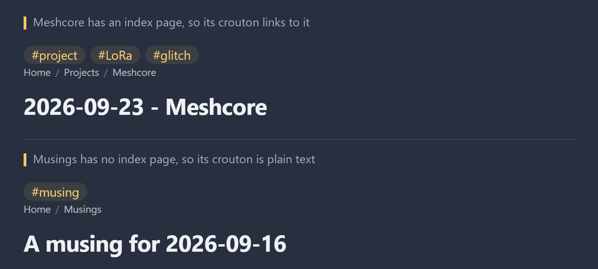

# Croutons

A [Digital Garden](https://github.com/oleeskild/digitalgarden) plugin that shows a note's folder trail under its title, like `Home / Projects / Meshcore`. When a page exists at a folder's URL, that folder's crouton becomes a link.



## Folder index pages

Folders don't have pages, so a normal breadcrumb trail can only show their names. But you can give a folder a page by putting a note at the folder's URL:

```
Projects/Meshcore/Meshcore - README.md    dg-permalink: projects/meshcore
Projects/Meshcore/Some plans.md           → /projects/meshcore/some-plans/
```

On *Some plans*, the trail is `Home / Projects / Meshcore`, with **Meshcore** linking to the README. On the README itself, the Meshcore crouton is left out, since the title is right there.

It doesn't matter what the index note is called or how it got to that URL. `index.md`, `Meshcore - README.md`, or a "folder note" beside the folder (`Projects/Meshcore.md`) all work. Croutons learns each folder's URL from the notes in it, so it uses exactly the same slugs as your garden. A side effect: you can delete the end of any URL and land on a real page.

Folders without an index page are shown as plain text.

## Settings

| Setting | Default | |
|---|---|---|
| Home label | `Home` | First crouton, linking to the home page. Leave empty to hide it. |
| Separator | `/` | Shown between croutons (hidden from screen readers). |

These match the Breadcrumbs plugin, so switching is painless. They can also be set with the `CROUTONS_HOME_LABEL` and `CROUTONS_SEPARATOR` environment variables.

## `crouton-label`

Set `crouton-label` in a folder index note's properties to change how that folder appears in every trail:

```yaml
crouton-label: "Meshcore 🛰️"
```

It's plain text, and only works on index notes. The Obsidian publisher only sends custom properties when its note-properties option is on.

## Styling

```html
<nav class="croutons" aria-label="Breadcrumb">
  <ol>
    <li class="crouton crouton--link"><a href="/">Home</a><span class="crouton-sep" aria-hidden="true">/</span></li>
    <li class="crouton crouton--plain">Musings</li>
  </ol>
</nav>
```

Linked and plain croutons look the same by default. Target `.crouton--link` or `.crouton--plain` to tell them apart.

## Installing

Install from this repo's URL, or copy the folder to `src/plugins/croutons/` in your garden. **Disable the Breadcrumbs plugin first**, or you'll get two trails.

If a note has a `dg-permalink` that isn't under its folder's URL, the build log shows one `[plugins] croutons:` line for it. Its trail still links correctly.

## Credit

Inspired by [Breadcrumbs](https://github.com/oleeskild/garden-plugin-breadcrumbs) by Ole Eskild Steensen. Croutons is an independent implementation; no Breadcrumbs code is used.

MIT licence.
